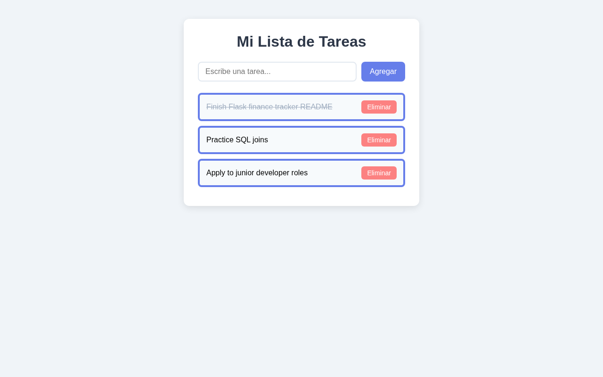

# ✅ To-Do List

A simple, clean to-do list app built with vanilla JavaScript. Tasks are saved in the browser with `localStorage`, so they are still there after you reload the page. The interface is in Spanish ("Mi Lista de Tareas").

🔗 **[Live Demo](https://coderblockch.github.io/todo-list/)**



## Features

- ➕ Add a task with the **Agregar** button or by pressing **Enter** (empty tasks are ignored)
- ✔️ Click a task to mark it as completed (shown with a strikethrough); click again to undo
- 🗑️ Delete a task with the **Eliminar** button
- 💾 Tasks persist across page reloads using `localStorage`

## Tech Stack

- HTML5
- CSS3
- Vanilla JavaScript (DOM manipulation, event listeners, `localStorage`, JSON)

## Run Locally

No build step or dependencies. Open `index.html` in your browser, or serve the folder:

```bash
git clone https://github.com/coderblockch/todo-list.git
cd todo-list
python3 -m http.server 8000
# then open http://localhost:8000
```

## How It Works

Tasks are kept in an array of `{ text, completed }` objects. Every change (add, toggle, delete) updates the array, saves it to `localStorage` as JSON, and re-renders the list.

## Project Structure

```
todo-list/
├── index.html   # markup
├── style.css    # styles
├── script.js    # task logic and localStorage persistence
└── docs/
    └── screenshot.png
```

## Author

**David Jimenez**, Sacramento, CA · [GitHub @coderblockch](https://github.com/coderblockch) · [Portfolio](https://portfolio-bay-nine-59.vercel.app)
