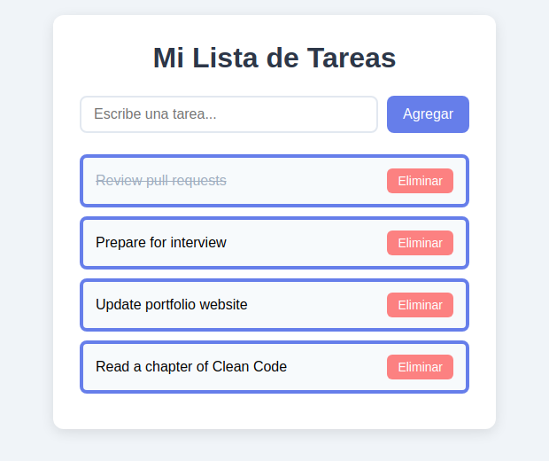

# TO-DO List

A simple, fast to-do list web app built with vanilla HTML, CSS, and JavaScript. Add tasks, mark them complete, delete them, and your list is saved automatically in the browser — no backend, no build step, no dependencies.

> The interface is in Spanish (*"Mi Lista de Tareas"*).

## Screenshot



## Features

- **Add tasks** with the input field or by pressing `Enter`.
- **Mark tasks complete** by clicking the task text (adds a strikethrough).
- **Delete tasks** with the *Eliminar* button.
- **Automatic persistence** via `localStorage` — your tasks survive page reloads and browser restarts.
- **Resilient loading** — corrupted saved data is handled gracefully instead of breaking the app.
- **Zero dependencies** and fully responsive layout.

## Tech Stack

- HTML5
- CSS3 (Flexbox)
- Vanilla JavaScript (ES6)
- Browser `localStorage` API

## Getting Started

No build tools or installation required.

### Option 1 — Open directly

Clone the repo and open `index.html` in your browser:

```bash
git clone https://github.com/coderblockch/todo-list.git
cd todo-list
# then open index.html in your browser (e.g. double-click it)
```

### Option 2 — Serve locally

Some browsers behave more consistently when files are served over HTTP:

```bash
git clone https://github.com/coderblockch/todo-list.git
cd todo-list
python3 -m http.server 8000
# then visit http://localhost:8000
```

## Project Structure

```
todo-list/
├── index.html   # Markup and app container
├── style.css    # Styling
├── script.js    # App logic (add / complete / delete / persist)
└── docs/        # Screenshots used in this README
```

## How It Works

Tasks are stored as an array of `{ text, completed }` objects. Every change re-renders the list from that array and writes it back to `localStorage` under the `tasks` key, so state stays in sync with what's displayed.

## License

Released under the [MIT License](LICENSE).
